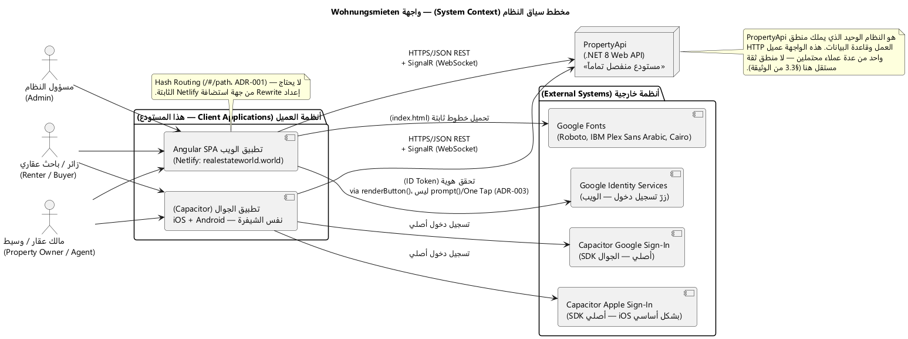
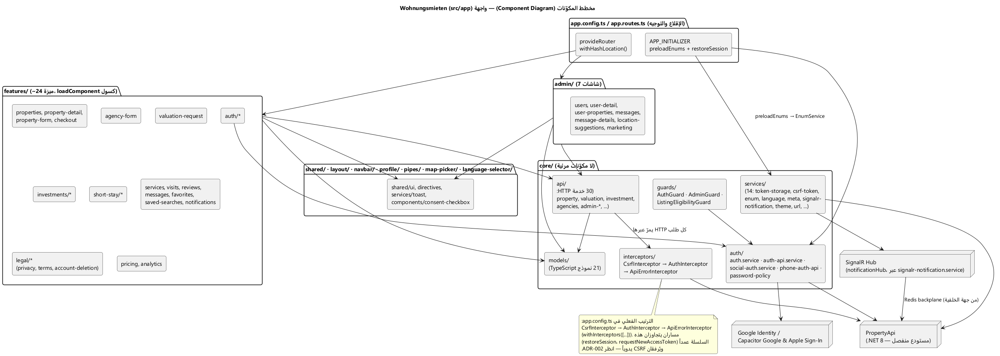
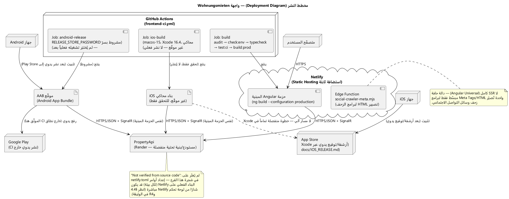
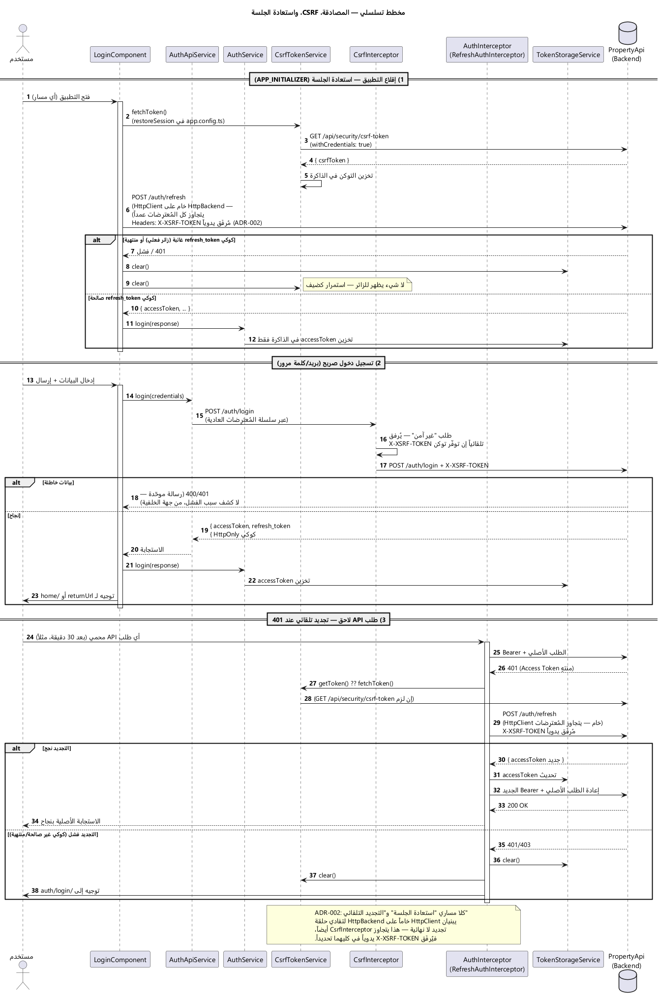
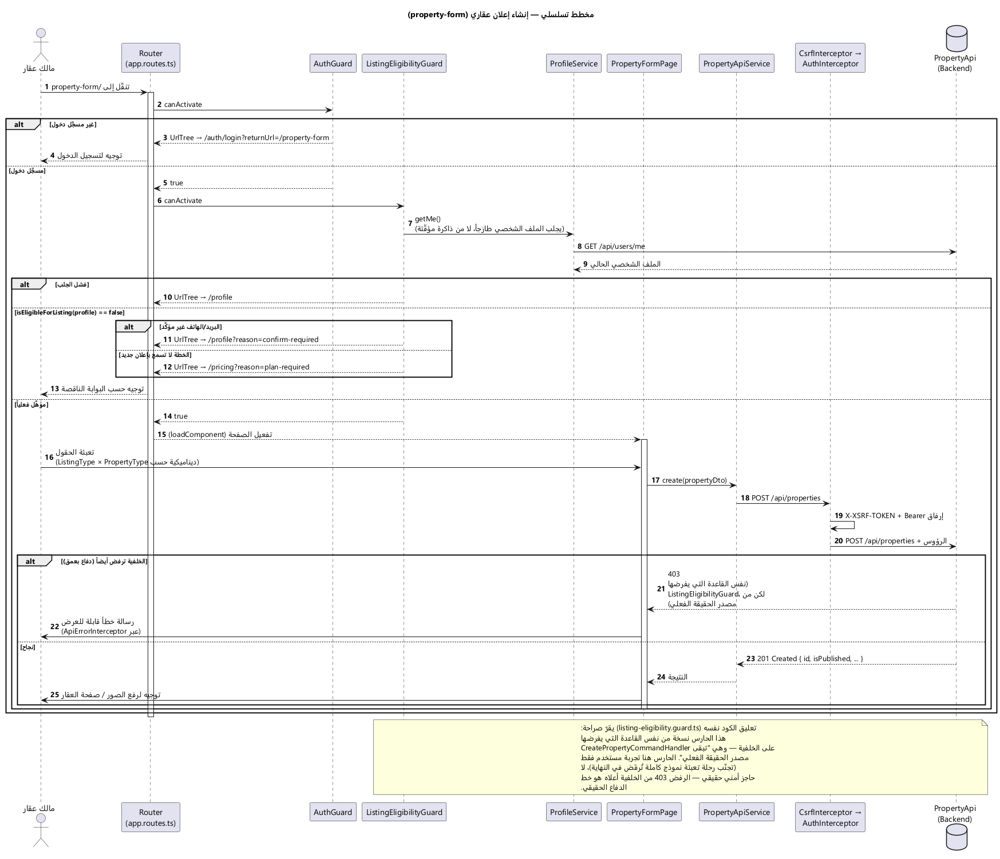

# وثيقة المرجع المعماري (Architectural Reference Document — ARD)
## واجهة HudhudNest (Angular) — منصّة العقارات (Yaqeen Real Estate / HudhudNest)

| | |
|---|---|
| **اسم النظام** | HudhudNest Frontend (Angular 20 SPA + Capacitor 8 iOS/Android) |
| **إصدار الوثيقة** | 1.0 |
| **تاريخ الإصدار** | 2026-09-12 |
| **الحالة** | معتمدة — مطابقة للكود الفعلي في فرع `claude/valuation-customer-ui` (commit `e35e812`) |
| **المستودع** | `Naeem-Ba/HudhudNest` (مستودع مستقل تماماً عن الخلفية `HudhudNestApi`) |
| **نطاق الفحص** | تحليل مباشر لشجرة `src/app`: 4 طبقات (`core`/`features`/`admin`/`shared`)، ~24 ميزة (lazy-loaded)، 30 خدمة API، 4 معترِضات، 3 حرّاس، تطبيقا Capacitor (iOS/Android)، خط أنابيب CI (`frontend-ci.yml`) |

### سجلّ المراجعات (Revision History)

| الإصدار | التاريخ | الوصف | مبني على Commit |
|---|---|---|---|
| 1.0 | 2026-09-12 | الإصدار الأول لهذه الوثيقة الرسمية (ARD) — بالتوازي مع `docs/FRONTEND-REFERENCE.md` الموجود مسبقاً (مرجع حيّ من طراز مختلف، آخر تحديث 2026-08-27 عند `e64daeb`؛ الفرعان يتقاطعان في الأدلة لكن هذه الوثيقة منظَّمة بصيغة ARD الرسمية القابلة للمقارنة المباشرة مع `HudhudNestApi-REFERENCE`/`ARD-HudhudNestApi`) | `e35e812` |

> **ملاحظة اتساق:** بعض الحقائق أدناه أُعيد التحقق منها مباشرة من الشيفرة الحالية وتخالف ما ورد في `FRONTEND-REFERENCE.md` v5 (المكتوبة عند `e64daeb`، أقدم بـ53 commit) — أبرزها: **مشكلة CSRF الحرجة الموصوفة في تلك الوثيقة (§4.1، B-20) مُصلَحة فعلياً في هذا الكود** (`CsrfInterceptor` + `CsrfTokenService` موجودان ومطبَّقان على مساري التجديد اليدويين أيضاً — انظر §4.5 وADR-002 أدناه). لا تعتمد على القسم الحرج في تلك الوثيقة دون إعادة تحقق.

---

## 1. المقدمة

### 1.1 الغرض من الوثيقة

توثيق المعمارية الفعلية لواجهة **HudhudNest** (تطبيق Angular أحادي الصفحة + غلاف Capacitor للجوال) كما هي مطبَّقة اليوم في الشيفرة المصدرية. كل ادّعاء هنا تم التحقق منه بالرجوع مباشرة إلى `app.routes.ts`، `app.config.ts`، خدمات `core/`، ملفات الإعداد (`angular.json`, `capacitor.config.ts`, `.github/workflows/frontend-ci.yml`)، وليس من وثائق سابقة قد تكون قديمة.

**الجمهور المستهدف:**

| الفئة | الفائدة من الوثيقة |
|---|---|
| مطوّرو الواجهة الجدد | فهم طبقات الكود، عقد الاتصال مع الخلفية، وقواعد الفريق الملزمة قبل الكتابة |
| مطوّرو الخلفية (HudhudNestApi) | فهم كيف تستهلك الواجهة عقود الـ API، وأين تكمن حدود التزامن بين المستودعين |
| مهندسو DevOps / المحمول | فهم بنية النشر (Netlify + Capacitor iOS/Android) وخط أنابيب CI |
| قادة تقنيون | فهم القيود المعمارية الحالية (حزمة أدائية، تغطية اختبارات، فجوات الوكالات/الوكالة) |

### 1.2 نطاق الوثيقة

**ما تغطيه:** تطبيق Angular 20 (Standalone Components، بدون NgModules) في `src/app/`، غلاف Capacitor 8 لنشر iOS/Android من نفس الشيفرة، عقد HTTP/JSON مع الخلفية `HudhudNestApi` (مستودع Git منفصل تماماً)، ومسار النشر عبر Netlify (ويب) وGitHub Actions (CI + بناء Android/iOS).

**ما لا تغطيه:**
- الشيفرة الداخلية للخلفية `HudhudNestApi` — تُذكر هنا فقط من زاوية العقد (REST/JSON، الكوكيز، CORS، CSRF)؛ راجع `ARD-HudhudNestApi.md` في مستودع الخلفية لتفاصيلها.
- كل الميزات الأربع والعشرين بعمق متساوٍ — التركيز الأعمق على: المصادقة (بما فيها CSRF وتسجيل الدخول الاجتماعي)، دورة حياة الإعلان (`property-form` + `ListingEligibilityGuard`)، والنشر عبر Netlify/Capacitor. نظرة أخفّ على: الوكالات العقارية، الاستثمار العقاري، الإقامة القصيرة، سوق الخدمات.
- تفاصيل تصميم الواجهة المرئية (UI/UX، نظام الألوان) — موثَّقة في `docs/UIUX_FIXES_SUMMARY.md` و`styles.scss` مباشرة.

### 1.3 تعريفات ومصطلحات

| المصطلح | التعريف |
|---|---|
| **ARD** | هذه الوثيقة. |
| **SPA** | Single-Page Application — تطبيق صفحة واحدة، التوجيه يتم في المتصفح. |
| **Standalone Component** | مكوّن Angular لا يحتاج `NgModule` مضيفاً — النمط الوحيد المستخدَم في هذا الكود. |
| **Signal** | بدائل Angular التفاعلية الحديثة (`signal()`) بدل RxJS/`BehaviorSubject` لحالة المكوّن المحلية. |
| **OnPush** | استراتيجية كشف تغيير تقتصر على تغيّر المدخلات/الإشارات صراحة، لا فحص شامل لكل شجرة المكوّنات. |
| **CSRF / XSRF** | تزوير طلب عبر الموقع؛ يُمنع هنا عبر توكن مُعاد في جسم JSON، انظر §4.5. |
| **Capacitor** | إطار يغلّف نفس شيفرة الويب داخل تطبيق iOS/Android أصلي مع وصول لواجهات برمجة أصلية (تسجيل دخول Google/Apple الأصلي، مثلاً). |
| **Hash Routing** | توجيه Angular بصيغة `/#/path` بدل مسارات HTML5 — كان خيارًا متعمَّدًا هنا، أُزيل لاحقًا، انظر ADR-001/ADR-001-R. |

### 1.4 المراجع

| المرجع | الموقع |
|---|---|
| المرجع المعماري السابق (نمط "حيّ"، تفاصيل تشغيلية أعمق لكل دورة) | `docs/FRONTEND-REFERENCE.md` |
| بنية المستودعين معاً | `docs/PROJECT-STRUCTURE.md` |
| مرجع الخلفية المقابل | `docs/HudhudNestApi-REFERENCE.md` (هذا المستودع) وَ`docs/architecture/ARD/ARD-HudhudNestApi.md` (مستودع الخلفية) |
| عقود API الموثَّقة | `FRONTEND_BACKEND_CONTRACT.md` |
| سجلّ عيوب الإصدار | `docs/RELEASE-BLOCKERS-AR.md` |
| دليل نشر iOS | `docs/IOS_BUILD.md`, `docs/IOS_RELEASE.md`, `docs/IOS_SETUP.md` |
| مخططات PlantUML المصاحبة | `docs/architecture/ARD/diagrams/*.puml` |

---

## 2. محركات المعمارية (Architectural Drivers)

### 2.1 متطلبات العمل

HudhudNest هي الواجهة الويب/جوال الوحيدة لمنصّة Yaqeen Real Estate، مستخلَصة من `app.routes.ts` الفعلي:

| المجال الوظيفي | الوظائف الأساسية | المسارات/الميزات ذات الصلة |
|---|---|---|
| الحسابات والمصادقة | تسجيل/دخول بالبريد أو الهاتف (OTP)، تسجيل دخول اجتماعي (Google/Apple — ويب وأصلي عبر Capacitor)، استعادة كلمة المرور، تأكيد بريد | `features/auth/*` (login, register, send-otp, verify-otp, forgot/reset-password, phone-register, phone-password-reset, verify-email, phone-reverify, phone-change) |
| إدارة العقارات (Listings) | تصفّح/بحث، إنشاء/تعديل عبر نموذج ديناميكي حسب النوع، صور، تمديد/تمييز مدفوع | `features/properties`, `features/property-detail`, `features/property-form`, `features/checkout` |
| المكاتب العقارية (Agencies) | تسجيل/تعديل مكتب عقاري (صفحة واحدة تخدم الحالتين) | `features/agency-form` — **أول route لـ `AgenciesController` في هذه الواجهة بالكامل** (تعليق الكود نفسه) |
| التقييم العقاري (Valuation) | تقديم طلب تقييم مجهول الهوية (بدون تسجيل دخول) | `features/valuation-request` — **مسار عام بلا `AuthGuard` بتصميم متعمَّد**، يطابق كون `ValuationInquiry.RequesterId` اختيارياً في الخلفية |
| الاستثمار العقاري (Investments) | تصفّح مشاريع استثمارية، قائمة مراقبة، لوحة إدارية (نشر/تعديل) | `features/investments/*`, `features/investments/admin/*` |
| الإقامة القصيرة (Short-Stay) | تصفّح، حجز، إدارة وحدات المضيف | `features/short-stay/*` |
| سوق الخدمات | طلبات خدمة (نقل/تشطيب) | `features/services` |
| التفاعل | زيارات، تقييمات، رسائل، مفضّلات، بحث محفوظ، إشعارات فورية (SignalR) | `features/visits`, `features/reviews`, `features/messages`, `features/favorites`, `features/saved-searches`, `features/notifications` |
| القانوني والامتثال | سياسة الخصوصية، شروط الخدمة، حذف الحساب (متطلَّب من متاجر التطبيقات) | `features/legal/*` |
| الإدارة | مستخدمون، رسائل، اقتراحات مواقع، تسويق (عروض/عملاء محتملين/استبيانات)، استثمارات | `admin/*` (7 شاشات) |
| البنية التحتية للمنتج | تسعير الخطط، تحليلات، اختيار لغة | `features/pricing`, `features/analytics`, `language-selector` |

**متطلبات غير وظيفية بارزة مستخلَصة من الكود نفسه:**
- **لا يوجد منطق عمل مستقل في الواجهة:** كل قرار تفويض (`AdminGuard`, `ListingEligibilityGuard`) يوثّق صراحة في تعليقاته أن الخلفية "تبقى مصدر الحقيقة الفعلي" — الحارس تجربة مستخدم فقط، لا حاجز أمني حقيقي.
- **دعم عربي أولاً (Arabic-first):** `defaultLanguage: 'ar'` في `TranslateModule.forRoot`، واتجاه الصفحة يُضبَط ديناميكياً عبر `LanguageService`.
- **قابلية النشر على الجوال من نفس القاعدة البرمجية:** `webDir: 'dist/HudhudNest/browser'` في `capacitor.config.ts` — لا شيفرة منفصلة لكل منصّة.

### 2.2 متطلبات الجودة (Quality Attributes)

| الصفة | كيف تتحقق فعليّاً في الكود | الدليل |
|---|---|---|
| **الأمان (Security)** | CSRF بتوكن مُعاد في جسم JSON (`CsrfTokenService` + `CsrfInterceptor`)، توكن الوصول في الذاكرة فقط (لا `localStorage`)، توكن التحديث في كوكي `HttpOnly` يديره المتصفّح/الخلفية حصراً | `core/services/csrf-token.service.ts`, `core/services/token-storage.service.ts` |
| **الأداء (Performance)** | كل الميزات (~24) محمَّلة كسولاً (`loadComponent`)؛ ميزانية حزمة أوّلية صارمة في `angular.json` (`650kB` تحذير / `1MB` خطأ) | `angular.json` (`budgets`) |
| **قابلية الصيانة (Maintainability)** | Standalone فقط، `inject()` بدل حقن المُنشئ، `OnPush`+`signal()` إلزاميان لكل مكوّن جديد (قواعد مكتوبة صراحة في `FRONTEND-REFERENCE.md §13`، مُتحقَّق منها بصرياً في المكوّنات المفحوصة) | بنية `src/app` نفسها |
| **قابلية النشر (Deployability)** | خط أنابيب CI واحد بثلاث مهام: بناء/تدقيق الويب، بناء Android Release AAB موقَّع (مشروط بوجود أسرار)، بناء iOS Simulator غير موقَّع | `.github/workflows/frontend-ci.yml` |
| **إمكانية المراقبة (Observability)** | **غير موجودة فعلياً** — لا Sentry، لا Application Insights، لا Google Analytics في الشيفرة (بحث مباشر، صفر نتائج). الأخطاء تُحوَّل لرسائل مستخدم عبر `ApiErrorInterceptor` فقط، دون إرسالها لأي نظام مراقبة خارجي | بحث `src/` كامل |
| **إمكانية الوصول للجوال (Mobile-first)** | نفس الشيفرة تُبنى إلى Android (Gradle/AAB موقَّع) وiOS (Xcode، محاكي غير موقَّع في CI) عبر Capacitor 8، بتسجيل دخول Google/Apple **أصلي** منفصل عن مسار الويب | `capacitor.config.ts`, `@capacitor-community/apple-sign-in`, `@capawesome/capacitor-google-sign-in` |

### 2.3 القيود (Constraints)

| القيد | الأثر المعماري |
|---|---|
| **مستودعان منفصلان تماماً (Frontend/Backend)** | أي تغيير في عقد HTTP يتطلّب تنسيقاً يدوياً بين مستودعي Git؛ لا أداة فحص نوع مشتركة تكتشف عدم التطابق (نفس القيد الموثَّق من جهة الخلفية، ADR الأمني هناك). |
| **Netlify (ويب) وRender (خلفية) لا يشتركان بنفس النطاق المسجَّل** | يمنع قراءة كوكي CSRF عبر النطاقات من JavaScript — يفرض إعادة التوكن في جسم استجابة JSON بدل الاعتماد على آلية Angular المدمجة وحدها (§4.5، ADR-002). |
| **لا `process.env` وقت التشغيل في حزمة المتصفّح** | متغيرات البيئة (`GOOGLE_CLIENT_ID`, `API_URL`, ...) يجب أن تُخبَز في ملف مولَّد (`env.generated.ts`) وقت البناء عبر `tools/generate-env.mjs`، لا تُقرأ من العملية وقت التشغيل. |
| **`strict: false` في `tsconfig.json`** | فحص أنواع أضعف من الحد الأقصى الممكن في TypeScript؛ `tsconfig.strict.json` (`npm run typecheck:strict`) **مفروض في CI منذ 2026-09-24** بعد إصلاح أخطائه الـ 27؛ أي كود جديد يجب أن يمرّ به. |
| **حساب GitHub الحالي يعاني مشكلة فوترة (موثَّق في تعليق الـ workflow نفسه)** | مهمة `android-release` في CI **لم تُختبَر تشغيلها فعلياً بعد** — موثَّق صراحة كتحذير داخل `frontend-ci.yml` نفسه، لا افتراضاً من هذه الوثيقة. |
| **خطة Render "Free" للخلفية على Staging (قيد خارجي، من جهة الخلفية)** | يحدّ من قدرة اختبار الواجهة مقابل بيئة Staging حيّة بثقة كاملة؛ راجع قيود الخلفية المقابلة. |

---

## 3. نظرة عامة على النظام (System Overview)

### 3.1 وصف النظام

**HudhudNest** تطبيق **Angular 20** أحادي الصفحة (Standalone Components فقط، بلا `NgModule`) يُبنى مرّتين من نفس الشيفرة: حزمة ويب تُنشَر على **Netlify**، وتطبيقا جوال (iOS/Android) عبر **Capacitor 8** يغلّفان نفس الحزمة مع إضافات أصلية (تسجيل دخول Google/Apple أصلي، أزرار رجوع النظام). التوجيه يعتمد على **HTML5 History API** (مسارات حقيقية مثل `/properties/42`) — كان يعتمد على **Hash Location** (`/#/path`) حتى ADR-001-R. التعريب عبر `@ngx-translate` بثلاث لغات (`ar` الافتراضية، `en`, `de`). كل حالة تفاعلية محلية تُبنى بـ `signal()` واستراتيجية `OnPush` إلزامية.

النظام **بلا منطق عمل مستقل**: كل حارس مسار (`AuthGuard`, `AdminGuard`, `ListingEligibilityGuard`) تجربة مستخدم فقط — الخلفية تعيد رفض أي طلب لا يملك المستخدم صلاحيته الفعلية عليه بصرف النظر عمّا يسمح به الحارس محلياً.

### 3.2 سياق النظام (System Context)



*(المصدر القابل للتعديل: `diagrams/01-system-context.puml`)*

الواجهة عميل HTTP/WebSocket واحد من عدة عملاء محتملين للخلفية `HudhudNestApi` (مستودع منفصل تماماً). الأنظمة الخارجية المتصلة بها **مباشرة** (لا عبر الخلفية) هي فقط: Google Identity Services (تسجيل دخول ويب + One Tap السابق)، Apple/Google عبر مكوّنات Capacitor الأصلية على الجوال، وGoogle Fonts (خطوط ثابتة في `index.html`). كل استدعاء بيانات فعلي (عقارات، مستخدمون، إشعارات) يمرّ حصراً عبر `HudhudNestApi`.

### 3.3 الأهداف المعمارية

1. **إبقاء كل منطق الثقة على الخلفية** — أي حارس أو تحقق محلي هو تجربة مستخدم فقط، موثَّق صراحة على أنه كذلك في كل حارس.
2. **حزمة أوّلية صغيرة قدر الإمكان** عبر التحميل الكسول الشامل لكل الميزات دون استثناء.
3. **قاعدة برمجية واحدة لثلاث منصّات** (ويب، Android، iOS) دون تفرّع شيفرة.
4. **كل نص مرئي عبر مفتاح ترجمة** — لا نصوص حرفية في القوالب (قاعدة مفروضة يدوياً، لا آلياً، عبر `frontend-audit-guard.mjs` الذي يفحص أنماطاً أخرى فقط — لا يفحص هذه القاعدة تحديداً).

---

## 4. وجهات النظر المعمارية (Architectural Views)

### 4.1 وجهة النظر المنطقية (Logical View)



*(المصدر القابل للتعديل: `diagrams/03-component.puml`)*

**البنية الفعلية (مُحصاة من الشجرة):**

```
src/app/
├── core/                      لا مكوّنات مرئية — الطبقة الأساسية
│   ├── api/                   30 خدمة HTTP (property-api, valuation-api, investment-api, agencies-api, ...)
│   ├── auth/                  auth.service · auth-api.service · social-auth.service ·
│   │                          phone-auth-api.service · password-policy
│   ├── guards/                AuthGuard · AdminGuard · ListingEligibilityGuard
│   ├── interceptors/          CsrfInterceptor · AuthInterceptor(=RefreshAuthInterceptor) ·
│   │                          ApiErrorInterceptor
│   ├── models/                21 نموذج TypeScript (property, agency, valuation, investment, ...)
│   └── services/              14 خدمة عرضية (token-storage, csrf-token, enum, language, meta,
│                               signalr-notification, theme, url, lead, ...)
├── features/                  ~24 ميزة، كل واحدة loadComponent كسول بالكامل
├── admin/                     7 شاشات إدارية (users, user-detail, user-properties,
│                              messages, message-details, location-suggestions, marketing)
├── shared/                    ui/ · directives/ · services/ (toast) · components/consent-checkbox
├── layout/ navbar/ profile/ pipes/ map-picker/ language-selector/
├── app.config.ts              كل المزوّدات + APP_INITIALIZER (تحميل Enums + استعادة الجلسة)
└── app.routes.ts               كل المسارات، مسطَّحة (لا Route مضمَّن متداخل عدا شجرة Layout)
```

**نمط موحّد لكل خدمة API:** `@Injectable({ providedIn: 'root' })` + حقل `endpoint` ثابت + اعتماد على `BackendApiService` مركزي، **بلا `catchError` داخل الخدمة نفسها** (معالجة الأخطاء مركزية عبر `ApiErrorInterceptor`).

### 4.2 وجهة النظر التطويرية (Development View)

- تطبيق Angular واحد (`angular.json`)، بلا Monorepo متعدد المشاريع.
- **إدارة تبعيات عبر `package.json`** فقط — لا Central Package Management مماثل لما تستخدمه الخلفية.
- **التوليد قبل البناء إلزامي:** كل سكربت بناء (`build`, `build:staging`, `build:prod`) يستدعي `npm run generate:env` أولاً (`tools/generate-env.mjs`) لخبز متغيرات البيئة كثوابت TypeScript قبل أن يرى `ng build` الشيفرة — **حزمة المتصفّح لا تحتوي `process.env` إطلاقاً في وقت التشغيل.**
- **بوابة تدقيق مخصَّصة (`npm run audit:frontend`, `tools/frontend-audit-guard.mjs`):** تفحص آلياً — بلا حاجة لمراجعة يدوية — عن `bypassSecurityTrustHtml`، استخدام `[innerHTML]`/`.innerHTML=` مباشرةً، وأنماط تشبه أسرار مثبَّتة في الشيفرة (`api_key=`, `client_secret=`, ...)، بالإضافة لفحص Mojibake (ترميز نص عربي تالف).
- **الاختبار:** Karma + Jasmine، **41 ملف `.spec.ts`** فعلياً في الشجرة (عدّ مباشر هذه الجلسة) — لم يُشغَّل `ng test` أثناء إعداد هذه الوثيقة؛ الرقم غير مُتحقَّق تنفيذياً هنا، فقط عدد الملفات.
- **فحص أنواع مزدوج المستوى:** `npm run typecheck` (`tsconfig.app.json`, `strict: false`) و`npm run typecheck:strict` (`tsconfig.strict.json`: strict + noUncheckedIndexedAccess + noPropertyAccessFromIndexSignature) **كلاهما يُشغَّل في CI** منذ 2026-09-24.
- **فحص مفاتيح الترجمة (`npm run check:i18n`, `tools/check-i18n-keys.mjs`):** يفشل إذا استعمل الكود مفتاحًا ثابتًا غير موجود في `en.json`، أو إذا اختلفت مفاتيح ar/en/de. المفاتيح المبنية وقت التشغيل (`'X.STATUS_' + v`) لا تُفحص.

### 4.3 وجهة النظر العملية (Process View)

**سلسلة المُعترِضات الفعلية (`app.config.ts`):**

```
provideHttpClient(withInterceptors([
  CsrfInterceptor,      // يُرفق X-XSRF-TOKEN على كل طلب غير آمن لمسار API إن توفّر توكن
  AuthInterceptor,      // = RefreshAuthInterceptor: يُرفق Bearer، ويجدّد تلقائياً عند 401
  ApiErrorInterceptor   // يحوّل أخطاء HTTP إلى رسائل قابلة للعرض
]))
```

**إقلاع التطبيق (`APP_INITIALIZER`، بالترتيب المسجَّل):**
1. `preloadEnums(EnumService)` — يحمّل مسبقاً 9 مجموعات Enum من الخلفية؛ كل مجموعة تفشل بأمان إلى قائمة فارغة عبر `catchError` داخلي (استثناء موثَّق للقاعدة العامة "لا `catchError` في الخدمات" — مبرَّر لأنه إقلاع لا مسار مستخدم).
2. `restoreSession(...)` — يحاول `POST /auth/refresh` عبر `HttpClient` خام مبني على `HttpBackend` مباشرة، **متجاوزاً كل المُعترِضات الثلاثة أعلاه عمداً** (لتفادي حلقة تجديد لا نهائية لو مرّ عبر `AuthInterceptor` نفسه). لأن هذا يتجاوز `CsrfInterceptor` أيضاً، يُستدعى `csrfTokenService.fetchToken()` ويُرفق `X-XSRF-TOKEN` **يدوياً** قبل الطلب — هذا هو الإصلاح الفعلي لثغرة B-20 الموثَّقة تاريخياً (انظر §4.5).

**نمط موحّد لعرض الأخطاء:** `ApiErrorInterceptor` هو نقطة التحويل الوحيدة من استجابة HTTP فاشلة إلى رسالة قابلة للعرض للمستخدم — لا معالجة أخطاء مبعثرة في كل مكوّن يستدعي API.

### 4.4 وجهة النظر الفيزيائية/النشر (Deployment View)



*(المصدر القابل للتعديل: `diagrams/02-deployment.puml`)*

| | ويب (Netlify) | Android | iOS |
|---|---|---|---|
| آلية البناء | `npm run build:prod` (بعد `generate:env`) | `npm run android:sync` → `npx cap sync android` | `npm run ios:sync` → `npx cap sync ios` + إصلاح مسارات SPM |
| التوقيع/الإصدار | — (Netlify يستضيف الحزمة الثابتة مباشرة) | AAB موقَّع بمفتاح إنتاج حقيقي من GitHub Secrets (`RELEASE_STORE_PASSWORD`, ...) — **مشروط بوجود السرّ**، وإلا تُتخطّى الخطوة صراحة | محاكي غير موقَّع فقط في CI (`CODE_SIGNING_ALLOWED=NO`) — الأرشفة/التوقيع الفعلي خطوة يدوية في Xcode خارج CI (`docs/IOS_RELEASE.md`) |
| **ملاحظة تحقّق (v1.0):** لم يُعثَر على `netlify.toml` في شجرة هذا الفرع رغم وجود مجلد `netlify/edge-functions` (دالة حافة تُصيّر HTML لبرامج الزحف — ميزة المشاركة الاجتماعية). إعداد النشر الفعلي على Netlify (أوامر البناء، متغيرات البيئة لكل بيئة) **غير قابل للتحقق من شجرة المصدر وحدها في هذا الفرع** — قد يكون مُدارًا من واجهة Netlify مباشرة، أو موجوداً على فرع آخر. **Not verified from source code.** | | | |
| صورة النشر | Static SPA + `netlify/edge-functions/social-crawler-meta.mjs` (تصيير HTML بديل لبرامج زحف وسائل التواصل — لا SSR كامل) | `com.realestate.app` — `appId` في `capacitor.config.ts` | نفس `appId`، `scheme: capacitor`، `contentInset: automatic` |
| بيئات البناء | `environment.ts` (محلي) / `.staging` / `.prod` — تُفرَّق عبر `--configuration` في `ng build`، والقيم الفعلية تُخبَز وقت البناء من `env.generated.ts` | نفس حزمة الويب المبنية بـ`build:prod` | نفس حزمة الويب المبنية بـ`build:prod` |

**خط أنابيب CI (`'.github/workflows/frontend-ci.yml`، ثلاث مهام):**
1. **`build`** — على كل Push/PR لِـ `main`/`master`/`develop`: `audit:frontend` → `test:tools` + `version:check` → `check:env` → `check:i18n` → `typecheck` → `typecheck:strict` → `test:ci` (Karma + ChromeHeadless) → `build:prod`.
2. **`android-release`** — يعمل فقط عند Push إلى `main`، ويُشترَط وجود سرّ `RELEASE_STORE_PASSWORD`؛ يبني ويوقّع AAB. **موثَّق صراحة في الـ workflow نفسه أنه لم يُختبَر تشغيله فعلياً بعد** (مشكلة فوترة على حساب GitHub الحالي).
3. **`ios-build`** — على `macos-15` (اختيار صريح مؤرَّخ لتفادي `macos-latest` المتغيّر)، Xcode 16.4 مثبَّت صراحة، بناء محاكي غير موقَّع فقط (لا يتطلّب حساب Apple Developer).

### 4.5 وجهة النظر الأمنية (Security View)

**المصادقة:**
- **Access token:** حقل خاص في ذاكرة `TokenStorageService` — لا يلمس `localStorage`/`sessionStorage` إطلاقاً (`clear()` يمسح مفاتيح تاريخية قديمة فقط، دفاعياً).
- **Refresh token:** كوكي `refresh_token` — `HttpOnly` + `Secure` + `SameSite=None` — لا تستطيع JavaScript قراءته؛ يديره المتصفّح والخلفية حصراً.
- **تسجيل دخول اجتماعي، مساران منفصلان تماماً:**
  - **الويب:** Google Identity Services عبر زرّ مرئي (`renderButton` + نقرة برمجية) — **ليس** `prompt()`/One Tap. تعليق تاريخي مطوَّل في `social-auth.service.ts` يوثّق سبب التخلي عن `prompt()` (BUG-21): تحذيرات FedCM الفعلية من Chrome في الـ console، وتوثيق Google الرسمي الذي يصف `prompt()` بأنه "بديل ثانٍ" لا آلية استجابة نقرة أساسية.
  - **الجوال (Capacitor):** مكوّنات أصلية منفصلة — `@capawesome/capacitor-google-sign-in` وَ`@capacitor-community/apple-sign-in` — لا تمرّ عبر Google Identity Services للويب إطلاقاً.

**حماية CSRF (مُصلَحة فعلياً — تصحيح لِما ورد في `FRONTEND-REFERENCE.md` v5):**
- `CsrfTokenService` يجلب التوكن من `GET /api/security/csrf-token` (`withCredentials: true`) ويحتفظ به في الذاكرة.
- `CsrfInterceptor` (أول معترِض في السلسلة) يُرفق `X-XSRF-TOKEN` تلقائياً على أي طلب غير آمن (`POST`/`PUT`/`DELETE`/...) لمسار API فيه توكن متاح ولم يُرفَق مسبقاً.
- **المسارات التي تتجاوز سلسلة المُعترِضات عمداً** (`restoreSession` في `app.config.ts`، و`requestNewAccessToken` في `refresh-auth.interceptor.ts` — كلاهما يبني `HttpClient` خاماً على `HttpBackend` لتفادي حلقة تجديد لا نهائية) **تُرفق التوكن يدوياً** بعد `csrfTokenService.fetchToken()`/`getToken()` صراحة — هذا هو الإصلاح المحدَّد الذي يسدّ الثغرة التي وثّقتها المراجعة السابقة (B-20). راجع ADR-002.
- عند تسجيل الخروج أو فشل التجديد النهائي: `csrfTokenService.clear()` تُستدعى مع `tokenStorage.clear()` معاً — يمنع توكن CSRF قديماً من جلسة سابقة من التسرّب لجلسة جديدة.

**تفويض من جهة العميل (تجربة مستخدم فقط، لا حاجز حقيقي):**
- `AuthGuard`: يتحقق من صلاحية التوكن محلياً (`validateSession()` يفحص صيغة JWT وتاريخ `exp`) قبل توجيه لصفحة محمية — **الخلفية تعيد الفحص من جديد على كل طلب فعلي**.
- `AdminGuard`: يتحقق من `auth.isAdmin$` (مُشتَق من مطالبات التوكن نفسه) — **الأدوار الفعلية تُفرَض من الخلفية**، هذا الحارس تجربة مستخدم لمنع ومضة محتوى إداري قبل الرفض فقط.
- `ListingEligibilityGuard`: على `property-form` (الإنشاء فقط، ليس التعديل) — يجلب الملف الشخصي طازجاً من الخلفية ويوجّه بحسب حالة الأهلية؛ تعليق الملف نفسه يقرّ صراحة أن الخلفية تبقى مصدر الحقيقة الفعلي.

**بوابة تدقيق أمنية آلية (`npm run audit:frontend`):** تفحص عن `bypassSecurityTrustHtml`، `[innerHTML]`/`.innerHTML=` المباشر، وأنماط أسرار مثبَّتة في الشيفرة — تفشل البناء (`process.exitCode`) عند وجود أي منها، لا مجرد تحذير.

---

## 5. قرارات التصميم المعماري (Architectural Design Decisions)

### 5.1 أنماط المعمارية المستخدمة

| النمط | أين يُطبَّق | لماذا |
|---|---|---|
| **Standalone Components + Signals + OnPush** | كل مكوّن في الشجرة (قاعدة مكتوبة، لا NgModule واحد في المشروع) | يقلّل الشيفرة الصندوقية (Boilerplate)، ويجعل كشف التغيير قابلاً للتنبؤ ومُحسَّناً افتراضياً |
| **تحميل كسول شامل (Lazy Loading)** | كل ميزة في `app.routes.ts` عبر `loadComponent()` | حزمة أوّلية أصغر؛ المستخدم يحمّل فقط الشاشة التي يزورها |
| **معترِضات HTTP كخط أنابيب معالجة موحّد** | `CsrfInterceptor → AuthInterceptor → ApiErrorInterceptor` | فصل اهتمامات الأمان/المصادقة/معالجة الأخطاء عن كل خدمة API على حدة |
| **حرّاس كتجربة مستخدم، لا كحاجز أمني** | `AuthGuard`, `AdminGuard`, `ListingEligibilityGuard` — كلّها موثَّقة صراحة على أن الخلفية "تبقى مصدر الحقيقة" | يتجنّب وهم أمان زائف على جهة العميل |
| **خدمة توكن CSRF مستقلة عن آلية Angular المدمجة** | `CsrfTokenService` بدل `withXsrfConfiguration` | ضرورة فرضها غياب نطاق مشترك بين الواجهة والخلفية (§2.3، ADR-002) |

### 5.2 مبادئ التصميم

1. **الخلفية دائماً مصدر الحقيقة** — أي تحقق محلي (حارس، تحقق نموذج) هو تجربة مستخدم، لا أمان.
2. **لا حالة حسّاسة في تخزين المتصفّح الدائم** — لا توكن وصول أو تحديث في `localStorage`.
3. **كل نص مرئي مفتاح ترجمة** — لا نصوص عربية/إنجليزية حرفية مثبَّتة في القوالب.
4. **البيئة تُخبَز وقت البناء، لا تُقرأ وقت التشغيل** — `env.generated.ts` مولَّد، لا `process.env` حيّ في المتصفّح.
5. **مسار يتجاوز المُعترِضات عمداً يتحمّل مسؤولية أمانه بنفسه** — درس مباشر من إصلاح B-20 (قاعدة مكتوبة صراحة في `FRONTEND-REFERENCE.md §13.11`، ومطبَّقة فعلياً في الكود الحالي).

### 5.3 قرارات التكنولوجيا (مع التبرير)

| التقنية | الدور | التبرير المستخلَص من الاستخدام الفعلي |
|---|---|---|
| **Angular 20 (Standalone)** | إطار العرض | أحدث نمط رسمي من Angular، بلا `NgModule` إطلاقاً — يقلّل التعقيد البنيوي لمشروع متعدد الميزات (~24) |
| **HTML5 History (`provideRouter(routes)`)** | التوجيه | مسارات حقيقية قابلة للفهرسة من محركات البحث؛ معتمِد على قاعدة Rewrite في `public/_redirects` (موجودة فعلاً). كان المشروع يستخدم Hash Routing سابقًا — استُبدل، انظر ADR-001-R |
| **`@ngx-translate/core`** | التعريب | تحميل ملفات JSON وقت التشغيل (`TranslateHttpLoader`) بدل تجميع لغات متعددة في وقت البناء — يسمح بتبديل اللغة دون إعادة تحميل الحزمة |
| **Capacitor 8** | غلاف الجوال | يعيد استخدام نفس شيفرة الويب لـ iOS/Android بدل تطبيقين أصليين منفصلين؛ وصول لواجهات أصلية (تسجيل دخول Google/Apple) عند الحاجة فقط |
| **Leaflet** | الخرائط | مكتبة خرائط مفتوحة خفيفة، لا تتطلّب مفتاح API مدفوعاً كـ Google Maps |
| **`@microsoft/signalr`** | إشعارات فورية | يطابق اختيار الخلفية لـ SignalR — بروتوكول واحد على الطرفين |
| **Netlify Edge Function للمشاركة الاجتماعية** | تصيير HTML بديل لبرامج الزحف | يحلّ مشكلة "SPA لا تملك محتوى Meta Tags حقيقياً لبرامج الزحف" دون الحاجة لخادم SSR كامل (Angular Universal) |

### 5.4 سجلّ قرارات التصميم المعماري (ADR)

#### ADR-001 — توجيه بصيغة Hash (`/#/path`) بدل HTML5 History API

- **الحالة:** ⚠️ **مُستبدَل (Superseded)** بتاريخ 2026-10-02 — انظر ADR-001-R أدناه. القسم التالي محفوظ كسياق تاريخي فقط.
- **السياق:** الاستضافة على Netlify كملفات ثابتة (Static Hosting)؛ أي مسار عميق (`/properties/42`) يُطلَب مباشرة من المتصفّح (تحديث الصفحة، رابط مشارَك) يجب أن يعيد نفس `index.html` دون إعداد Rewrite إضافي من جهة الخادم.
- **القرار (السابق):** `provideRouter(routes, withHashLocation())` — كل التوجيه داخل الجزء بعد `#`، الذي لا يُرسَل للخادم إطلاقاً.
- **البدائل المرفوضة (وقتها):** مسارات HTML5 History مع قاعدة Rewrite على Netlify (`_redirects`/`netlify.toml`) — ممكن تقنياً، لكن **`netlify.toml` غير موجود في شجرة ذلك الفرع وقتها**، فالاعتماد على Hash Routing بدا أنه يزيل الحاجة لضبط ذلك الملف كشرط لعمل أي مسار عميق.
- **الأثر (الذي أدّى للاستبدال):** روابط تحمل `#` غير قابلة للفهرسة فعليًا من محركات البحث (أجزاء الـ fragment لا تُرسَل للخادم ولا تُعامَل كمسارات مستقلة من Google) — التخفيف عبر دالة Netlify Edge كان جزئيًا فقط (مسار `/properties/*` دون غيره)، ولم يُتحقَّق منه فعليًا ضد بيئة Netlify/Deno الحقيقية.

#### ADR-001-R — الاستبدال: مسارات حقيقية (HTML5 History / PathLocationStrategy)

- **الحالة:** مقبول ومطبَّق (2026-10-02).
- **السياق:** مشروع رفع الظهور في محركات البحث (Production SEO) يتطلّب أن يكون لكل عقار/صفحة رابطًا حقيقيًا قابلًا للفهرسة. العائق الذي بُرِّر به ADR-001 الأصلي — عدم وجود `netlify.toml`/قاعدة Rewrite — لم يعد قائمًا: `public/_redirects` يحتوي فعليًا على `/* /index.html 200` (أُضيف لاحقًا لسبب آخر — إصلاح كوكي المصادقة عبر النطاقات)، وهو تمامًا ما تحتاجه مسارات HTML5 History.
- **القرار:** إزالة `withHashLocation()` — `provideRouter(routes)` فقط. الروابط الحقيقية (`/properties/:id`) تطابق الآن تمامًا الروابط الأساسية (canonical) التي كانت `PropertyShareUrlService`/`MetaService` تبنيها أصلاً.
- **التوافق الخلفي:** روابط `#/...` الموزَّعة مسبقًا (رسائل بريد، مشاركات، إشارات مرجعية) يعالجها سكربت تمهيدي في `index.html` يحوّلها لمسارها الحقيقي قبل إقلاع Angular — انظر `src/index.html`.
- **تأثير جانبي محلول:** روابط تأكيد البريد/استعادة كلمة المرور (B-14 في `RELEASE-BLOCKERS-AR.md`) لم تعد تحتاج بادئة `#` من الخلفية إطلاقًا — أُزيلت من `EmailConfirmationUrlBuilder`/`PasswordResetUrlBuilder` في مستودع الخلفية بنفس التغيير.
- **الأدلة:** `app.config.ts`, `src/index.html`, `public/_redirects`.

#### ADR-002 — توكن CSRF مُعاد في جسم JSON عبر خدمة مخصَّصة، وإرفاق يدوي على المسارات المتجاوِزة للمُعترِضات

- **الحالة:** مقبول ومطبَّق — **يمثّل إصلاحاً لثغرة فعلية سبق توثيقها (B-20)**، لا تصميماً أولياً صحيحاً منذ البداية.
- **السياق:** الخلفية فعّلت حماية CSRF (`CookieCsrf:Enabled=true`)، والواجهة والخلفية لا يشتركان بنفس النطاق المسجَّل في أي بيئة غير محلية — آلية Angular المدمجة (`withXsrfConfiguration`، تعتمد على قراءة كوكي `document.cookie` من أصل الواجهة) لا تعمل بنيوياً عبر نطاقات غير مشتركة، بصرف النظر عن أي إعداد. المراجعة السابقة لهذه الوثيقة (`FRONTEND-REFERENCE.md` v5) وثّقت هذا كعطل حيّ: كل مستخدم يُسجَّل خروجه قسراً كل ~30 دقيقة.
- **القرار:** `GET /api/security/csrf-token` يُعيد التوكن في جسم JSON (لا كوكي وحدها)؛ `CsrfTokenService` يخزّنه في الذاكرة؛ `CsrfInterceptor` يُرفقه تلقائياً على مسار الطلبات العادية؛ **المسارات التي تتجاوز سلسلة المُعترِضات عمداً** (`restoreSession`, `requestNewAccessToken` — كلاهما يبني `HttpClient` خاماً على `HttpBackend` لتفادي حلقة تجديد لا نهائية) **تجلب وتُرفق التوكن يدوياً** قبل الطلب.
- **الأدلة:** `core/services/csrf-token.service.ts`, `core/interceptors/csrf.interceptor.ts`, `app.config.ts:49-57` (`restoreSession`), `core/interceptors/refresh-auth.interceptor.ts:144-153` (`requestNewAccessToken`).
- **البدائل المرفوضة:** الاعتماد فقط على `withXsrfConfiguration` المدمجة — **مُختبَرة فعلياً وتبيّن أنها لا تعمل عبر نطاقات غير مشتركة**؛ إلغاء CSRF من جهة الخلفية بدل إصلاح الواجهة — يفتح ثغرة أمنية حقيقية، مرفوض من جهة الخلفية (ADR مقابل هناك).
- **الأثر:** أي معترِض/مسار جديد يبني `HttpClient` خاماً لتفادي حلقة معترِضات يجب أن يتحمّل مسؤولية إرفاق أي رأس أمني تفرضه الخلفية بنفسه — قاعدة مكتوبة صراحة في `FRONTEND-REFERENCE.md §13.11` ومطبَّقة هنا فعلياً.
- **التحقق:** بحث حسّاس لحالة الأحرف عن `csrf|xsrf` في كامل `src/` (خارج `.spec.ts`) هذه الجلسة يعطي نتائج حقيقية موزَّعة على 4 ملفات إنتاجية (`app.config.ts`, `csrf.interceptor.ts`, `refresh-auth.interceptor.ts`, `csrf-token.service.ts`) — لا صفر نتائج كما كانت الحالة عند كتابة المراجعة السابقة.

#### ADR-003 — تسجيل دخول اجتماعي بمسارين منفصلين تماماً: زرّ Google Identity على الويب، مكوّنات Capacitor أصلية على الجوال

- **الحالة:** مقبول ومطبَّق.
- **السياق:** `prompt()`/One Tap من Google Identity Services تبيّن أنه غير موثوق بنيوياً (BUG-21): تحذيرات FedCM فعلية من Chrome، وردود `isSkippedMoment=true` أو تعليق حتى مهلة 60 ثانية بلا أي إشعار. توثيق Google الرسمي نفسه يصف `prompt()` بأنه "بديل ثانٍ"، لا آلية استجابة نقرة أساسية. على الجوال (Capacitor)، حزمة الويب هذه تعمل داخل `WebView`، حيث لتدفّق OAuth القائم على المتصفّح قيود وتجربة مستخدم أضعف من تسجيل دخول أصلي حقيقي.
- **القرار:** الويب يستخدم زرّ `renderButton()` مرئياً حقيقياً + نقرة برمجية (لا `prompt()`)؛ الجوال يستخدم مكوّنات Capacitor أصلية منفصلة كلياً (`@capawesome/capacitor-google-sign-in`, `@capacitor-community/apple-sign-in`) لا تمرّ عبر Google Identity Services للويب إطلاقاً.
- **الأدلة:** `core/auth/social-auth.service.ts` (تعليق تاريخي مطوَّل يوثّق BUG-21 والتشخيص الحيّ)، `package.json` (حزمتا Capacitor أعلاه)، commit `1857a6d`.
- **البدائل المرفوضة:** الاعتماد فقط على `prompt()`/One Tap (مرفوض: غير موثوق تجريبياً، موثَّق بالدليل الحيّ)؛ WebView OAuth عام على الجوال بدل SDK أصلي (مرفوض: تجربة مستخدم أضعف، وقيود متصفّح مضمَّن حقيقية على منصّات الجوال الحديثة).
- **الأثر:** منطقا تسجيل الدخول الاجتماعي (ويب/جوال) يجب صيانتهما بشكل منفصل تماماً — إصلاح في أحدهما لا ينسحب تلقائياً على الآخر.

#### ADR-004 — بيئة تُخبَز وقت البناء عبر سكربت Node، لا تُقرأ من `process.env` وقت التشغيل

- **الحالة:** مقبول ومطبَّق.
- **السياق:** حزمة `@angular/build:application` لا تُدرِج كائن `process` عالمياً في حزمة المتصفّح، ولا يوجد `--define`/بناء بديل (`@ngx-env/builder`) في هذا المشروع — أي كود يقرأ `process.env.X` مباشرة وقت التشغيل يُقيَّم دائماً إلى `undefined` في الحزمة المنشورة.
- **القرار:** `tools/generate-env.mjs` يُشغَّل قبل كل بناء (`npm run generate:env`، مُستدعًى من `start`/`build`/`postinstall` جميعاً) ويكتب `src/environments/env.generated.ts` بقيم حقيقية كثوابت TypeScript حرفية، مقروءة من عملية Node وقت البناء (متطابقة السلوك بين Windows المحلية وصورة بناء Netlify/CI على Linux). الملف الناتج مُستبعَد من Git (`gitignore`) ويُعاد توليده في كل بناء.
- **الأدلة:** `tools/generate-env.mjs` (تعليق الرأس يشرح "لماذا" بالتفصيل)، `package.json` (`generate:env` في `start`/`build`/`postinstall`).
- **البدائل المرفوضة:** بناء Angular مخصَّص (`@ngx-env/builder` أو ما شابه) لدعم `process.env` وقت البناء مباشرة — لم يُتَّخَذ القرار به في هذا المشروع.
- **الأثر:** أي متغيّر بيئة جديد يحتاجه المتصفّح يجب أن يُضاف صراحة لِـ `tools/generate-env.mjs` — إضافته فقط إلى `.env`/GitHub Secrets دون تحديث هذا السكربت لن يصل إطلاقاً إلى الحزمة المبنية.

---

## 6. اعتبارات الجودة (Quality Attribute Considerations)

### 6.1 الأداء

**الحدّ الفعلي في `angular.json` (منذ 2026-09-24):** `maximumWarning: 600kB`, `maximumError: 700kB` (حزمة أوّلية؛ كان 650kB/1MB فلم يكن الحد يُفشل البناء فعليًا). **آخر قياس: 579.62 kB خام / 156.31 kB منقول** (2026-09-24، بعد تحميل `@microsoft/signalr` كسولًا عند أول `connect()` بدل الحزمة الأولية — كانت 635.62 kB).

**استراتيجيات التحسين الفعلية في الكود:**
- تحميل كسول شامل لكل ميزة (`loadComponent`) — لا حزمة أولية تحمل ميزات لم يزرها المستخدم بعد.
- `OnPush` إلزامي — يقلّص دورات كشف التغيير غير الضرورية.
- `@angular/service-worker` **تبعية موجودة في `package.json` لكن غير مُفعَّلة فعلياً** — لا استدعاء `provideServiceWorker`/`ServiceWorkerModule` في `app.config.ts` (بحث مباشر، صفر نتائج) — لا تخزين مؤقت PWA فعلي رغم توفّر البنية التحتية له.

### 6.2 قابلية التوسّع

غير منطبقة بنفس معنى الخلفية — الواجهة SPA ثابتة تُستضاف كملفات، وتتوسّع أفقياً بطبيعتها عبر شبكة توصيل المحتوى الخاصة بـNetlify. القيد الوحيد ذو الصلة هو حجم الحزمة (§6.1)، لا سعة خادم.

### 6.3 الأمان

راجع القسم 4.5 بالتفصيل الكامل (CSRF، تسجيل الدخول الاجتماعي، الحرّاس، بوابة `audit:frontend`).

**نقطة إضافية مهمة:** لا معالجة استثناءات عامة (`ErrorHandler` مخصَّص) ولا إرسال أخطاء وقت التشغيل لأي خدمة مراقبة خارجية — أي عطل غير متوقَّع في مكوّن يعتمد على آلية Angular الافتراضية (طباعة في Console المتصفّح) فقط، **لا رؤية مركزية لفريق التطوير عن أعطال المستخدمين الفعليين في الإنتاج.**

### 6.4 قابلية الصيانة

- قواعد فريق مكتوبة صراحة وملزمة (`FRONTEND-REFERENCE.md §13`): `OnPush`+`signal()`، `inject()` لا حقن مُنشئ، `takeUntilDestroyed`، كل نص مفتاح ترجمة، `apiToCamelCase()` يبقى حيث يُستخدَم، لا `catchError` في الخدمات، لا تغليف نقطة نهاية إدارية في خدمة عميل.
- **هذه القواعد غير مفروضة آلياً بالكامل** — `frontend-audit-guard.mjs` يفحص فئة أضيق (أمان Mojibake/`innerHTML`/أسرار)، وليس كل القواعد أعلاه (لا فحص آلي، مثلاً، لالتزام كل مكوّن جديد بـ `OnPush`). الاعتماد الفعلي هو انضباط المطوّر + المراجعة اليدوية، لا بوابة CI تفرضها.

### 6.5 قابلية النشر

خط أنابيب CI واحد بثلاث منصّات (§4.4) — الويب مُختبَر وممارَس بانتظام (كل Push/PR)، بينما مسارا الجوال (Android الموقَّع، iOS) إما غير مُختبَرين فعلياً بعد (Android، بسبب مشكلة فوترة موثَّقة) أو يقتصران على تحقق بناء غير موقَّع (iOS) دون نشر فعلي آلي لمتاجر التطبيقات.

### 6.6 إمكانية المراقبة (Observability)

**غير موجودة فعلياً في هذا الكود.** لا Sentry، لا Application Insights، لا Google Analytics، لا `ErrorHandler` مخصَّص يرسل الأعطال لأي مكان. هذا يعني أن أي عطل في الإنتاج يمرّ دون أي إشعار استباقي لفريق التطوير — الاكتشاف الوحيد الفعلي هو تقارير المستخدمين أو الفحص اليدوي.

---

## 7. المخاطر المعمارية (Architectural Risks)

| # | الخطر | الاحتمال | الأثر | التخفيف الحالي / الموصى به |
|---|---|---|---|---|
| R1 | لا إمكانية مراقبة فعلية (§6.6) — أعطال الإنتاج تمرّ بصمت | مؤكَّد (قيد حالي موثَّق) | عالٍ (لا رؤية لجودة تجربة المستخدم الفعلية) | إضافة أداة مراقبة أخطاء عميل (Sentry أو مكافئ) — لم يُقرَّر بعد |
| R2 | نموّ الحزمة الأوّلية (بلغت 635.62 kB في 2026-09-23) | منخفض الآن | متوسط | ✅ 579.62 kB بعد تحميل SignalR كسولًا؛ حدّ الخطأ صار 700kB فيُفشل البناء فعلًا. أكبر المكوّنات المتبقية: `@angular/core` 125 kB، `@angular/router` 77 kB، `@angular/forms` 49 kB، `navbar.component` 42 kB |
| R3 | تسجيل دخول Google للويب معتمِد بنيوياً على واجهات Google Identity Services الخارجية وسلوكها المتغيّر (تاريخ BUG-21 دليل حيّ على هذا) | متوسط (تغييرات مزوّد خارج تحكّم الفريق) | متوسط | مراقبة تحذيرات Console المرتبطة بـFedCM دورياً؛ لا حل جذري ممكن غير مراقبة مستمرة |
| R4 | `netlify.toml` غير موجود في شجرة هذا الفرع رغم أدلة تاريخية على وجوده في مكان ما (commit `a94cffe` على فرع آخر غير مندمج في هذا) | مؤكَّد الغياب من هذا الفرع تحديداً | متوسط (إعداد نشر غير قابل للتحقق من الكود — قد يعتمد على ضبط يدوي في واجهة Netlify عرضة للانحراف بصمت) | التحقق من إعداد Netlify الفعلي مباشرة من لوحة التحكم، وتوثيقه في الشيفرة (`netlify.toml`) إن لم يكن موجوداً هناك أيضاً |
| R5 | `android-release` في CI لم تُختبَر تشغيلها فعلياً (مشكلة فوترة GitHub موثَّقة في الـ workflow نفسه) | مؤكَّد | متوسط–عالٍ (أول تشغيل فعلي قد يكشف أعطالاً غير متوقَّعة في خطوة حسّاسة — توقيع إصدار حقيقي) | تشغيل تجريبي فور حل مشكلة الفوترة، قبل الاعتماد على المسار لإصدار حقيقي |
| R6 | `tsconfig.strict.json` (فحص أنواع أشدّ) موجود لكن غير مفروض في CI — قد ينحرف عن `tsconfig.app.json` دون أن يلاحظ أحد | منخفض–متوسط | منخفض–متوسط (أخطاء أنواع تمرّ بصمت في CI العادي) | إضافة `npm run typecheck:strict` إلى `frontend-ci.yml`، أو حذف الملف إن لم يعد الهدف تفعيله لاحقاً |
| R7 | مستودعان منفصلان بلا فحص نوع مشترك لعقد HTTP (قيد معماري متبادَل مع الخلفية) | متوسط | متوسط–عالٍ (عطل CSRF التاريخي B-20 مثال فعلي وقع بسبب هذا بالضبط) | `FRONTEND_BACKEND_CONTRACT.md` كمرجع يدوي؛ لا أداة آلية تكتشف عدم التطابق عند تغيّر أحد الطرفين |

---

## 8. الخاتمة

### 8.1 الملخص

**HudhudNest** واجهة Angular 20 حديثة (Standalone + Signals + OnPush بلا استثناء)، تخدم ثلاث منصّات (ويب/Android/iOS) من قاعدة برمجية واحدة عبر Capacitor. أبرز نقاط القوة الموثَّقة فعلياً: **إصلاح فعلي وموثَّق جيداً لثغرة CSRF حرجة سبقت هذه الوثيقة** (ADR-002)، بوابة تدقيق أمني آلية بسيطة لكن فعّالة (`audit:frontend`)، وانضباط معماري واضح في القواعد المكتوبة (حتى لو لم تكن كلها مفروضة آلياً). أبرز الفجوات الصادقة: **لا مراقبة أخطاء إنتاج فعلية إطلاقاً** (R1)، مسار نشر Android لم يُختبَر بعد فعلياً (R5)، وإعداد Netlify الفعلي غير قابل للتحقق من هذا الفرع (R4).

### 8.2 المراجعات المستقبلية

يجب مراجعة هذه الوثيقة عند:
- إضافة أي أداة مراقبة أخطاء عميل (يُغلق R1).
- أول تشغيل فعلي ناجح لمهمة `android-release` (يُحدَّث R5 من "غير مُختبَر" إلى حالة فعلية).
- العثور على/إنشاء `netlify.toml` فعلي لهذا الفرع أو تأكيد إعداد Netlify من لوحة التحكم مباشرة (يُغلق R4).
- أي تغيير في مسار تسجيل الدخول الاجتماعي (ويب أو جوال) — تاريخ هذا المسار (BUG-21) يُظهر أنه عرضة لتغيّرات سلوك مزوّدين خارجيين.
- قياس فعلي جديد لحجم الحزمة بعد أي ميزة كبيرة جديدة.

---

## 9. الملحق — المخططات التسلسلية للعمليات الجوهرية

### 9.1 تسجيل الدخول واستعادة الجلسة (Auth + CSRF)


*(المصدر القابل للتعديل: `diagrams/04-sequence-auth.puml`)*

### 9.2 إنشاء إعلان عقاري (Property Listing Creation)


*(المصدر القابل للتعديل: `diagrams/05-sequence-property-listing.puml`)*

---

*نهاية الوثيقة. جميع المخططات متوفرة بصيغة PlantUML قابلة للتعديل في `docs/architecture/ARD/diagrams/*.puml`.*
